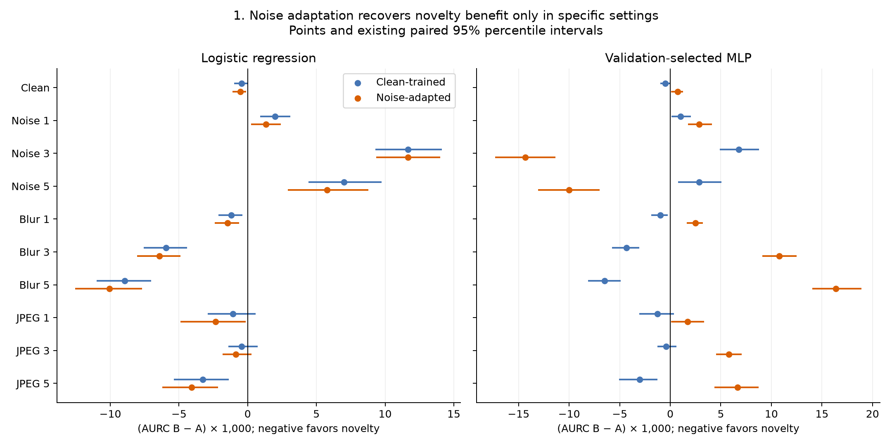
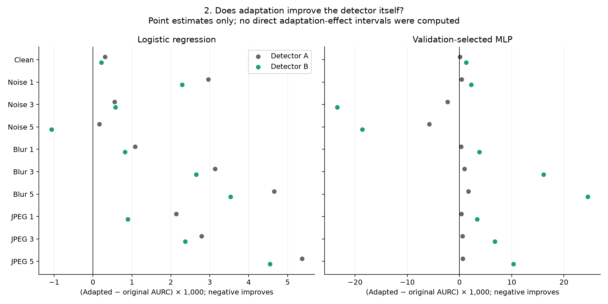
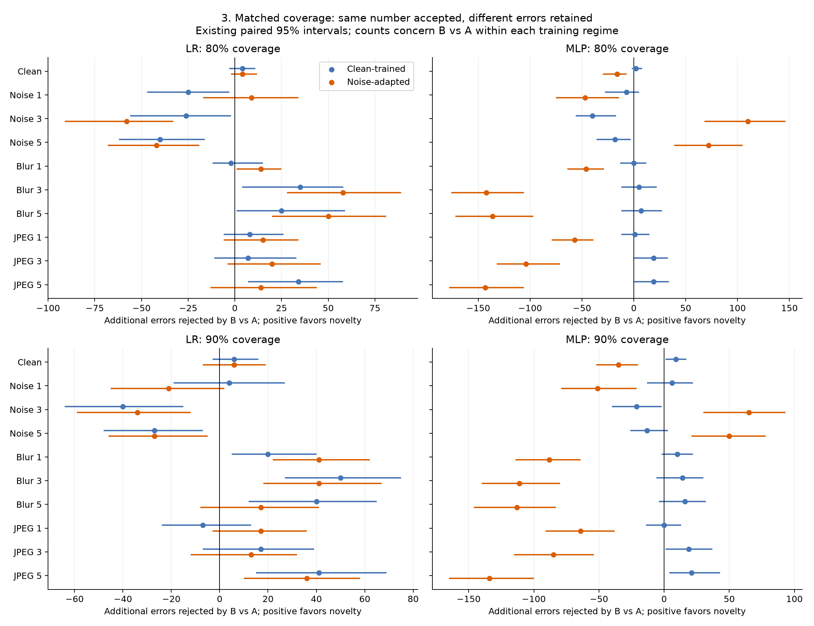

# What Gaussian-noise detector adaptation establishes

**Main finding:** noise adaptation recovers mean novelty’s incremental error-detection benefit for the MLP under Gaussian noise severities 3 and 5. It does not recover that benefit under mild noise or with logistic regression. The MLP gain comes with worse clean performance and worse transfer to every tested blur/JPEG condition. This is conditional evidence of a usable shifted feature relationship, not a universal fix or a causal mechanism.

## Design and evidence checks

A uses four output features; B adds mean predicted-class novelty. Original detectors trained on clean detector-train images. Adapted detectors trained on equally weighted clean/noise-1/noise-3/noise-5 versions of the same 10,000 detector-training sources. Corresponding versions of 5,000 validation sources set checkpoint and seed selection by equal-weight mean per-condition AURC. CNN weights, centroids, clean novelty standardization, predictions and test error targets were fixed. Adapted feature scalers used the training mixture. Blur and JPEG were excluded from adaptation development.

This script reads every evaluation score table and the metric, bootstrap, threshold, seed-sensitivity, training-history and validation tables. It verifies the completed evaluation manifest, all-example AUROC/AURC and coverage counts against cached scores, contrast arithmetic, and frozen-threshold decisions. It does not fit models, alter selections, or recompute bootstrap intervals. The figures use existing 2,000-resample paired percentile intervals; no multiplicity correction or pooling is applied.

## 1. Novelty benefit is recovered selectively

Define Δ = AURC(B) − AURC(A). Negative favors novelty. Gamma = Δadapted − Δoriginal; negative Gamma means the incremental effect improved, but recovery additionally requires negative adapted Δ with its interval below zero.

| Condition | Adapted LR B−A [95% CI] | Adapted MLP B−A [95% CI] |
| --- | --- | --- |
| clean | -0.000542 [-0.001094, -0.000100]; benefit | +0.000731 [+0.000099, +0.001251]; harm |
| gaussian_noise_1 | +0.001326 [+0.000254, +0.002415]; harm | +0.002873 [+0.001745, +0.004122]; harm |
| gaussian_noise_3 | +0.011678 [+0.009359, +0.014006]; harm | -0.014348 [-0.017326, -0.011344]; benefit |
| gaussian_noise_5 | +0.005780 [+0.002926, +0.008786]; harm | -0.009998 [-0.013088, -0.006982]; benefit |
| motion_blur_1 | -0.001463 [-0.002392, -0.000636]; benefit | +0.002476 [+0.001614, +0.003227]; harm |
| motion_blur_3 | -0.006426 [-0.008060, -0.004898]; benefit | +0.010794 [+0.009097, +0.012493]; harm |
| motion_blur_5 | -0.010058 [-0.012540, -0.007676]; benefit | +0.016365 [+0.014052, +0.018922]; harm |
| jpeg_compression_1 | -0.002334 [-0.004883, -0.000158]; benefit | +0.001733 [+0.000074, +0.003343]; harm |
| jpeg_compression_3 | -0.000862 [-0.001823, +0.000278]; inconclusive | +0.005785 [+0.004526, +0.007077]; harm |
| jpeg_compression_5 | -0.004079 [-0.006214, -0.002172]; benefit | +0.006673 [+0.004380, +0.008738]; harm |

MLP noise-3 Δ moves from +0.006791 to −0.014348, with Gamma −0.021140 [−0.024770, −0.017489]. Noise-5 Δ moves from +0.002850 to −0.009998, with Gamma −0.012848 [−0.016783, −0.008999]. Both satisfy the recovery criterion under the registered exploratory procedure. Mild noise instead worsens: adapted Δ=+0.002873.

LR remains harmful under all three noise severities. Its negative Gamma at mild noise is an instructive counterexample: the harm shrinks but does not become a benefit. LR retains benefits on clean and all blur conditions, and JPEG 1/5; JPEG 3 is inconclusive. Thus adaptation is not intrinsically harmful, and the recovery result depends on the detector family. This experiment alone does not isolate nonlinearity as its cause.

## 2. Recovery reflects better B performance, not merely a worse A

Absolute selected-MLP AURCs below retain all four systems. Differences across corruption conditions also reflect different error prevalence; compare systems within each row.

| Condition | Original A | Original B | Adapted A | Adapted B |
| --- | --- | --- | --- | --- |
| clean | 0.005435 | 0.004955 | 0.005522 | 0.006253 |
| gaussian_noise_1 | 0.051151 | 0.052183 | 0.051565 | 0.054438 |
| gaussian_noise_3 | 0.466479 | 0.473270 | 0.464198 | 0.449849 |
| gaussian_noise_5 | 0.631307 | 0.634157 | 0.625540 | 0.615542 |
| motion_blur_1 | 0.014805 | 0.013810 | 0.015123 | 0.017599 |
| motion_blur_3 | 0.090446 | 0.086119 | 0.091404 | 0.102198 |
| motion_blur_5 | 0.161690 | 0.155191 | 0.163418 | 0.179782 |
| jpeg_compression_1 | 0.024587 | 0.023323 | 0.024963 | 0.026696 |
| jpeg_compression_3 | 0.051680 | 0.051271 | 0.052251 | 0.058036 |
| jpeg_compression_5 | 0.088049 | 0.085044 | 0.088693 | 0.095366 |

Under noise 3, adapted B improves from 0.473270 to 0.449849 while A also improves slightly (0.466479→0.464198). Under noise 5, B improves 0.634157→0.615542 while A improves 0.631307→0.625540. Therefore the recovered B−A effect is not produced solely by degrading A. Direct adapted-versus-original A/B differences are point estimates; the stored intervals test B−A and Gamma, not each direct adaptation effect.

On clean images, adapted B worsens from 0.004955 to 0.006253 (about 26.2% higher AURC), and AUROC falls from 0.9401 to 0.9190. Under blur/JPEG, adapted B also worsens in every condition, while A changes comparatively little. The formerly helpful mean-novelty input becomes harmful for the selected adapted MLP. This supports a specialization/tradeoff interpretation rather than preserved cross-corruption usefulness.

## 3. Equal coverage confirms practical gains and losses

At 90% coverage all systems keep exactly 9,000 predictions. Positive additional errors caught = accepted errors(A) − accepted errors(B). The table uses adapted MLPs; paired count intervals are from the original bootstrap file.

| Condition | Adapted A errors | Adapted B errors | Additional caught [95% CI] |
| --- | --- | --- | --- |
| clean | 152 | 187 | -35 [-52.0, -20.0] |
| gaussian_noise_1 | 1349 | 1400 | -51 [-79.0, -21.0] |
| gaussian_noise_3 | 5530 | 5465 | +65 [+30.0, +93.0] |
| gaussian_noise_5 | 6794 | 6744 | +50 [+21.0, +78.0] |
| motion_blur_1 | 467 | 555 | -88 [-114.0, -64.0] |
| motion_blur_3 | 1904 | 2015 | -111 [-140.0, -80.0] |
| motion_blur_5 | 2775 | 2888 | -113 [-146.0, -83.0] |
| jpeg_compression_1 | 676 | 740 | -64 [-91.0, -38.0] |
| jpeg_compression_3 | 1286 | 1371 | -85 [-115.0, -54.0] |
| jpeg_compression_5 | 1821 | 1955 | -134 [-165.0, -100.0] |

At noise 3, B catches 65 more errors than adapted A at 90% coverage; at noise 5 it catches 50 more, and both count intervals exclude zero. At 80%, the corresponding gains are 110 and 72. Clean adaptation reverses the original benefit: original B catches nine more errors than original A at 90%, while adapted B leaves 35 more errors than adapted A. Blur/JPEG all show negative adapted-MLP count differences at 90%, with intervals below zero. These are benefits/losses at matched rejection budgets, not merely effects of rejecting more images.

## 4. Frozen thresholds improve severe-noise risk but do not make it safe

Each system retains its own clean-validation threshold targeting 90% coverage. Cells show actual coverage / error rate among accepted images; they are not exact-coverage comparisons.

| Condition | Original B | Adapted A | Adapted B |
| --- | --- | --- | --- |
| clean | 90.47% / 1.59% | 90.25% / 1.75% | 90.19% / 2.12% |
| gaussian_noise_1 | 69.98% / 6.67% | 68.88% / 6.43% | 69.23% / 7.12% |
| gaussian_noise_3 | 48.92% / 53.31% | 45.85% / 51.25% | 40.41% / 46.50% |
| gaussian_noise_5 | 46.60% / 68.80% | 43.11% / 66.46% | 34.80% / 62.21% |
| motion_blur_1 | 83.34% / 3.13% | 83.43% / 3.28% | 83.36% / 3.97% |
| motion_blur_3 | 64.93% / 11.04% | 64.54% / 11.47% | 65.07% / 13.20% |
| motion_blur_5 | 57.12% / 18.00% | 56.90% / 18.37% | 57.28% / 20.65% |
| jpeg_compression_1 | 79.33% / 3.90% | 78.89% / 3.89% | 78.18% / 4.48% |
| jpeg_compression_3 | 69.68% / 6.95% | 68.59% / 7.06% | 67.71% / 7.52% |
| jpeg_compression_5 | 62.46% / 9.70% | 61.45% / 9.55% | 60.27% / 10.67% |

At noise 5, adapted B accepts only 34.80% of images and 62.21% of those are wrong; original B accepts 46.60% with 68.80% wrong. Lower accepted risk therefore partly accompanies more abstention. The equal-coverage gains above show a real ranking improvement, but neither result implies reliable classification under severe noise or a risk guarantee under shift.

Within the clean confident-unanimous subset (8,850 images, 131 errors), original A/B retain 49/45 errors at 90% subset coverage, versus adapted A/B 48/64. Adapted B also has worse subset AUROC (0.8650 versus adapted A 0.8854). Noise adaptation sacrifices part of the original motivating clean confident-error benefit. Subset metrics are descriptive; the stored bootstrap intervals concern all-example comparisons, not these subsets.

## 5. Seed sensitivity, validation selection and training budget

Validation selected MLP seeds A=22, B=33; these choices are retained, not revised using test performance.

All three same-seed comparisons and all nine A/B seed pairings have negative adapted B−A under noise 3/5, and positive B−A on clean, mild noise, blur and JPEG. Thus the sign pattern is not confined to the two validation-selected detector seeds. These dependent seed pairings are a sensitivity check, not nine independent experiments or evidence across independently trained CNN ensembles.

| Feature set | Seed | Best epoch | Epochs run | Optimizer steps |
| --- | --- | --- | --- | --- |
| A | 11 | 62 | 82 | 12874 |
| A | 22 | 188 | 200 | 31400 |
| A | 33 | 65 | 85 | 13345 |
| B | 11 | 189 | 200 | 31400 |
| B | 22 | 195 | 200 | 31400 |
| B | 33 | 194 | 200 | 31400 |

All B seeds reach the 200-epoch cap with best epochs 189/195/194. A uses best epochs 62/188/65. This documents the executed budget; it does not justify extending training after inspecting test outcomes. Mixture epochs process four times as many rows as the original clean-only epoch, and the adaptation regime changes scalers and validation selection objective. Neither noise exposure, compute nor nonlinear architecture is isolated as the unique cause. Validation performance guided selection; it is not an independent evaluation result.

## Interpretation for the paper

> With the CNN ensemble and representation novelty reference held fixed, Gaussian-noise detector adaptation recovered a mean-novelty benefit beyond output features for the MLP at moderate and severe noise, but not at mild noise or for logistic regression. Recovery coincided with poorer clean and blur/JPEG performance, indicating a condition-dependent adaptation tradeoff.

Because fixed novelty features become useful in these shifted settings under the adapted MLP, the original failure cannot be interpreted as complete absence of usable novelty information. This supports a detector-transfer limitation for those conditions, while allowing reduced feature discrimination to coexist. It does not demonstrate a causal neural mechanism, prove that feature information is universally independent of outputs, or establish broad transfer.

Every condition was previously inspected; this is exploratory, with many unadjusted comparisons and one CNN ensemble. Blur/JPEG were withheld from adaptation development but are not untouched confirmatory tests. Bootstrap intervals condition on the selected models; detector seeds do not capture CNN-training variability. The original H1 tests novelty variation, whereas this experiment compares A versus B using mean novelty: its H1 outcome is unchanged.

The clean original LR B−A interval here barely crosses zero, while the earlier final-evaluation interval barely excluded zero. The point estimate is identical; the bootstrap seed changed (adaptation 20261107 versus original 20261103). With 2,000 draws and a near-zero endpoint, this boundary sensitivity is expected Monte Carlo variability. Report the registered intervals for each analysis and do not select whichever gives a desired significance label.

Source tables are in the parent folder: bootstrap.csv, metrics.csv, threshold_metrics.csv, seed_sensitivity.csv, training_history.csv, validation_metrics.csv and validation_scores.csv. Registration/environment/freeze/completion records provide provenance; cached per-condition scores reproduce ranking and threshold results. No new statistical tests or training were performed for this report.
